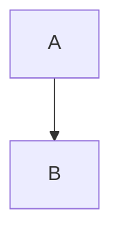

# Intro

Plain paragraph with **bold** and a footnote[^1].

<script>alert('raw block script')</script>

Inline <b onclick="alert(1)">bold html</b> and  here.

<iframe src="https://evil.example/"></iframe>

## Links

- [external](https://example.com/page)
- [javascript link](javascript:alert('js'))
- [data link](data:text/html;base64,PHNjcmlwdD5hbGVydCgxKTwvc2NyaXB0Pg==)
- [vbscript link](vbscript:msgbox)
- [sibling doc](./sibling.md)
- [string sibling](../other.txt#frag)
- [anchor](#intro)
- [missing](./missing.md)


## Tables and tasks

| Name | Value |
| ---- | ----- |
| a    | 1     |
| b    | 2     |

- [x] done
- [ ] todo

## Math

Inline $E = mc^2$ and display:

$$
\int_0^1 x^2 \, dx
$$

## Code

```ts
const answer: number = 42
```



```mermaid
invalid diagram here
```

[^1]: The footnote text.
